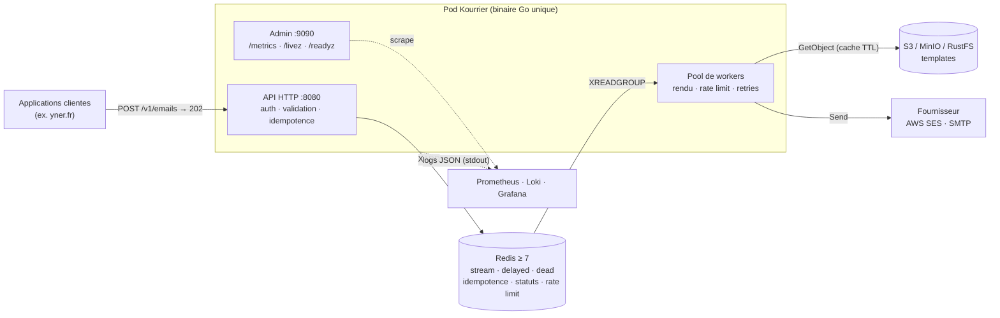
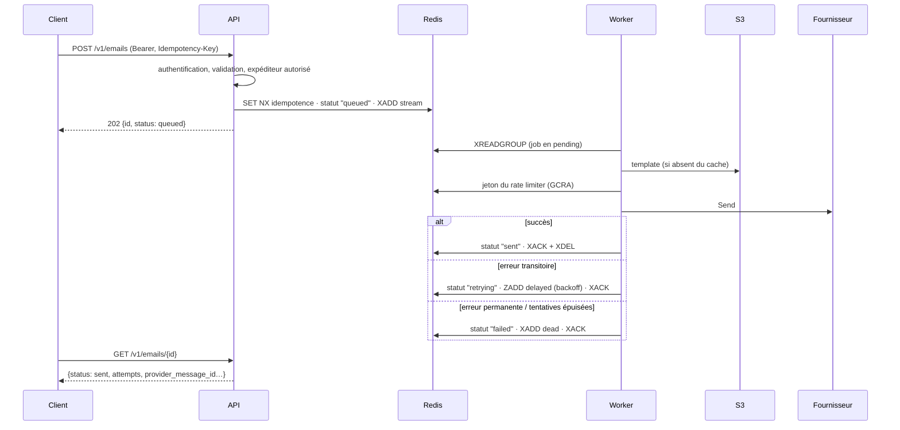

# Architecture

Kourrier est un binaire Go unique ([ADR 001](adr/0001-go-monolithe-modulaire.md)). Redis, le stockage S3 et le fournisseur d'e-mails sont des **dépendances externes**, en dehors du Pod.

## Cycle de vie d'un e-mail

## Packages

| Package | Rôle |
|---------|------|
| `cmd/kourrier` | Point d'entrée et CLI (`serve`, `keygen`, `dlq`, `healthcheck`). |
| `internal/app` | Racine de composition : construit les composants depuis la configuration, gère le cycle de vie et l'arrêt propre. |
| `internal/config` | Configuration par variables d'environnement `KOURRIER_*`. |
| `internal/api` | API HTTP publique et serveur d'administration. |
| `internal/tenant` | Tenants, clés API, expéditeurs autorisés ([ADR 008](adr/0008-authentification-multi-tenant.md)). |
| `internal/queue` | Interface `Queue` et implémentation Redis Streams ([ADR 006](adr/0006-fiabilite-redis-streams.md)). |
| `internal/worker` | Pool de workers : rendu, rate limit, envoi, retries. |
| `internal/templates` | Chargement, cache et rendu des templates ([ADR 010](adr/0010-format-des-templates.md)). |
| `internal/storage` | Interface `storage.Provider` ; `s3store`, `fsstore` ([ADR 003](adr/0003-stockage-templates-s3.md)). |
| `internal/provider` | Interface `provider.Provider` ; `ses`, `smtp`, `console`, `filesystem`, `memory` ([ADR 004](adr/0004-abstraction-fournisseur.md)). |
| `internal/ratelimit` | Limiteurs GCRA Redis et local ([ADR 009](adr/0009-rate-limiting-distribue.md)). |
| `internal/idempotency` | Clés d'idempotence ([ADR 007](adr/0007-idempotence.md)). |
| `internal/status` | Statut de livraison par e-mail. |
| `internal/retry` | Classification permanente / transitoire et backoff. |
| `internal/observability` | Métriques Prometheus et logs ([ADR 005](adr/0005-observabilite-native.md)). |
| `internal/mail` | Types du domaine et validation. |
