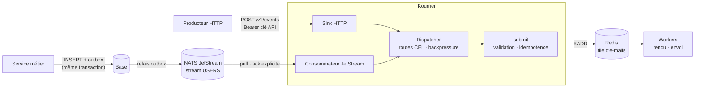

# Événements : des CloudEvents aux e-mails

Kourrier peut écouter les **événements de domaine** de vos services (`user.signed_up`, `order.paid`…) et en déduire les e-mails à envoyer, grâce à des **routes déclaratives**. Le code métier publie ce qui s'est passé ; il ne sait pas qu'un e-mail existe.

Décisions associées : [ADR 012](adr/0012-entree-evenementielle-cloudevents.md) (entrée événementielle), [ADR 013](adr/0013-routage-declaratif-cel.md) (CEL), [ADR 014](adr/0014-nats-jetstream.md) (NATS JetStream).

## Quand l'utiliser ?

| Besoin | Entrée conseillée |
|--------|-------------------|
| Une application veut envoyer un e-mail précis, maintenant (reset de mot de passe, OTP) | `POST /v1/emails` ([API](api.md)) |
| Notifier à la suite d'un fait métier, sans coupler le service métier à l'e-mail | Événements |
| L'envoi doit être cohérent avec une transaction en base | Événements + *outbox* côté producteur |
| Plusieurs e-mails (client, admin, compta) pour un même fait | Événements : une route par e-mail |

Les deux entrées partagent le même chemin vers la file : validation, expéditeurs autorisés, idempotence, statuts, retries, DLQ et métriques sont identiques.

## Vue d'ensemble



## Démarrage rapide (local)

```sh
make up       # Redis, NATS (stream USERS) et Kourrier
make event    # publie examples/events/user-signed-up.json sur NATS
make logs     # affiche l'e-mail rendu
```

En local, le driver `console` affiche l'e-mail dans les logs de Kourrier (avec `make up-full`, il arrive dans Mailpit, <http://localhost:8125>). `make event-http` pousse le même événement sur `POST /v1/events`. Les routes de démonstration sont dans [examples/routes.yaml](../examples/routes.yaml).

## Le fichier de routes

Le fichier est indiqué par `KOURRIER_EVENTS_ROUTES_FILE` (une ConfigMap en Kubernetes, voir `events.routes` dans le chart). Sans ce fichier, l'entrée événementielle est désactivée et `POST /v1/events` répond `404`. Il est entièrement validé au démarrage : **la moindre erreur empêche Kourrier de démarrer**, et toutes les erreurs sont listées d'un coup.

```yaml
apiVersion: kourrier/v1alpha1          # obligatoire ; champs inconnus refusés

sources:
  nats:
    - name: shop-orders                # label des logs et métriques
      tenant: shop                     # les événements lus ici n'utilisent que les routes de "shop"
      stream: ORDERS                   # doit exister : Kourrier ne crée jamais de stream
      consumer: kourrier               # consommateur durable
      filter_subjects: ["orders.>"]    # optionnel
      ack_wait: 30s                    # optionnel, minimum 15s
      max_deliver: 0                   # optionnel, 0 = illimité (recommandé)
      max_ack_pending: 0               # optionnel, 0 = 256
      bind: false                      # true : consommateur géré ailleurs (NACK, Terraform)

routes:
  - name: order-receipt                # unique ; tag kourrier_route chez le fournisseur
    tenant: shop
    match:
      types: [com.shop.order.paid]     # obligatoire, égalité stricte
      source: /shop/orders             # optionnel, égalité stricte
      when: data.total > 0             # optionnel, CEL -> bool
    email:
      template: order-receipt          # template du tenant (ADR 010)
      to: data.customer.email          # CEL, obligatoire
      locale: data.?customer.locale    # CEL, optionnel (sinon locale par défaut)
      data: |                          # CEL, optionnel (sinon : data de l'événement)
        {"order_id": event.subject, "total": data.total,
         "lines": data.lines.map(l, l.label)}
      from: { email: billing@news.shop.fr, name: Shop }   # optionnel, doit être autorisé
      tags: { flow: billing }          # optionnel, 8 maximum
```

Règles de correspondance :

- Un événement est évalué **uniquement** avec les routes de son tenant : celui de la clé API (HTTP) ou celui de la source (NATS).
- Toutes les routes qui correspondent produisent chacune un e-mail. Une route dont `when` est faux est ignorée.
- Aucun e-mail n'est jamais créé sans route explicite : il n'y a pas de route « attrape-tout ».

## Expressions CEL

[CEL](https://cel.dev) est le langage d'expressions de Kubernetes (validation des CRD, `ValidatingAdmissionPolicy`). Il est non Turing-complet et sans I/O, et son coût d'évaluation est borné.

**Variables :**

| Variable | Type | Contenu |
|----------|------|---------|
| `event` | `map(string, dyn)` | `id`, `source`, `type`, `specversion`, `subject`, `time` (timestamp), `datacontenttype`, `dataschema` et les extensions (chaînes) |
| `data` | `dyn` | Charge utile JSON (`null` si absente). Les entiers restent des entiers (pas d'arrondi au-delà de 2^53). |

**Aide-mémoire :**

| Besoin | Expression |
|--------|------------|
| Champ imbriqué | `data.user.email` |
| Champ facultatif | `data.?user.locale.orValue("fr")` |
| Tester la présence | `has(data.coupon)` |
| Plusieurs destinataires | `[data.buyer.email, data.seller.email]` |
| Destinataire nommé | `{"email": data.email, "name": data.first_name + " " + data.last_name}` |
| Liste d'objets | `data.admins.map(a, {"email": a.email, "name": a.name})` |
| Filtrer une liste | `data.lines.filter(l, l.qty > 0)` |
| Condition | `data.plan == "pro" && !data.unsubscribed` |
| Chaînes | `data.email.lowerAscii()`, `data.code.startsWith("FR")` |
| Extension CloudEvents | `event.tenantid == "acme"` |
| Ternaire | `data.total > 100 ? "gold" : "standard"` |

**Ce que renvoie chaque champ :**

- `when` : un booléen.
- `to` : une adresse (`"a@b.fr"`), un objet `{email, name}` ou une liste de ces deux formes (50 destinataires au maximum).
- `locale` : une chaîne ; un optionnel vide signifie « locale par défaut ».
- `data` : un objet, qui devient les données du template.

**Échec explicite.** Un champ absent fait échouer la route (issue `rejected`) plutôt que de produire un e-mail incomplet. Pour un champ réellement facultatif, utilisez `?` et `orValue`.

**Bornes.** 4 Kio par expression, un coût de 100 000 unités maximum par évaluation et 32 niveaux de profondeur pour les valeurs produites.

## Tester ses routes (CI)

Les routes vivent idéalement dans le même dépôt que les templates et passent en revue de code. Deux commandes fonctionnent hors ligne, sans Redis ni broker :

```sh
# Syntaxe, types CEL, tenants et expéditeurs
kourrier routes check -tenants tenants.yaml routes.yaml

# E-mails produits par un événement d'exemple (sortie JSON, code retour != 0 si une route échoue)
kourrier routes test -tenants tenants.yaml -tenant shop -event fixtures/order-paid.json routes.yaml
```

Exemple de job GitHub Actions :

```yaml
- run: docker run --rm -v "$PWD:/w" -w /w ghcr.io/theo-mrn/kourrier:0.1.0 routes check -tenants tenants.yaml routes.yaml
```

## Transport HTTP : `POST /v1/events`

Kourrier accepte les modes *structured* (`Content-Type: application/cloudevents+json`) et *binary* (`ce-*` + `Content-Type: application/json`). L'appel est authentifié par la clé API du tenant.

```sh
curl -X POST http://localhost:8180/v1/events \
  -H "Authorization: Bearer $KEY" \
  -H "Content-Type: application/json" \
  -H "ce-specversion: 1.0" -H "ce-id: 42" -H "ce-source: /shop/orders" -H "ce-type: com.shop.order.paid" \
  -d '{"total": 30, "customer": {"email": "jane@example.com"}}'
```

Codes de réponse, à interpréter par l'émetteur pour décider d'un nouvel essai :

| Code | Signification | Réessayer ? |
|------|---------------|-------------|
| `202` | `accepted` (e-mails en file, voir `emails`) ou `ignored` (aucune route) | non |
| `400` | CloudEvent malformé | non |
| `413` | Événement trop gros (`KOURRIER_MAX_BODY_BYTES`) | non |
| `415` | Pas un CloudEvent, mode batch, données non JSON ou `specversion` ≠ 1.0 | non |
| `422` | Aucune route n'a pu produire d'e-mail (détail par route dans `errors`) | non |
| `503` | Redis indisponible ou backpressure (`Retry-After`) | **oui** |

Une réponse `202` peut contenir des `errors` : certaines routes ont échoué, d'autres ont produit leur e-mail. Les e-mails déjà créés ne sont pas recréés lors d'un nouvel envoi du même événement.

## Transport NATS JetStream

1. **Le stream appartient aux producteurs.** Kourrier ne le crée pas. Exemple :
   `nats stream add USERS --subjects 'users.>' --storage file --replicas 3 --max-age 7d`
2. **Format des messages.** Kourrier accepte un CloudEvent *structured* (corps JSON, avec ou sans `Content-Type: application/cloudevents+json`) ou *binary* (en-têtes `ce-*` + `Content-Type`).
3. **Identifiants.** Ils sont lus depuis des fichiers montés : `KOURRIER_EVENTS_NATS_CREDS_FILE` (JWT), `_NKEY_FILE`, `_TLS_CA_FILE`, `_TLS_CERT_FILE` / `_TLS_KEY_FILE` (mTLS). Voir `events.nats` dans le chart.
4. **Moindre privilège.** Pour un stream `USERS` et un consommateur `kourrier`, l'utilisateur NATS de Kourrier n'a besoin que de :

   ```text
   publish:
     $JS.API.CONSUMER.INFO.USERS.kourrier
     $JS.API.CONSUMER.MSG.NEXT.USERS.kourrier
     $JS.ACK.USERS.kourrier.>
     $JS.API.CONSUMER.CREATE.USERS.kourrier       # inutile avec bind: true
     $JS.API.CONSUMER.CREATE.USERS.kourrier.>     # inutile avec bind: true
   subscribe:
     _INBOX.>
   ```

   Vérifiez avec `nats --trace` sur votre version de serveur : les sujets de l'API JetStream évoluent. Avec `bind: true`, retirez les deux `CREATE` et gérez le consommateur de façon déclarative (NACK, Terraform).

Acquittements :

| Issue | Action | Effet |
|-------|--------|-------|
| `accepted`, `ignored` | `Ack` | |
| invalide, `rejected` | `Term` | jamais redélivré ; advisory `$JS.EVENT.ADVISORY.CONSUMER.MSG_TERMINATED.<stream>.<consumer>` à capturer pour garder une trace |
| `retry` (Redis) | `NakWithDelay` | 1 s, 2 s, 4 s… jusqu'à 1 min |
| `retry` (backpressure) | `NakWithDelay` | 30 s |

Une panne de NATS n'empêche ni le démarrage ni la readiness du Pod : la connexion est retentée indéfiniment en tâche de fond (`kourrier_event_source_up` passe à `0`).

## Pattern outbox

Pour qu'un e-mail ne parte que si la transaction métier est validée, et qu'il parte toujours dans ce cas :

1. Dans **la même transaction** que le changement métier, le service insère le CloudEvent complet (JSON *structured*) dans une table `outbox`.
2. Un **relais** publie chaque ligne sur NATS, tel quel, puis la marque comme publiée. Ce relais peut être Debezium Server avec le *outbox event router* configuré pour publier la colonne qui contient l'événement, ou un simple poller applicatif.
3. Kourrier consomme. Si le relais publie deux fois (crash entre la publication et le marquage), l'idempotence (`route + source + id`) absorbe le doublon.

Exemple de ligne d'outbox :

```json
{"specversion":"1.0","id":"8d0f…","source":"/shop/orders","type":"com.shop.order.paid","subject":"order-42",
 "time":"2026-11-12T10:00:00Z","data":{"total":30,"customer":{"email":"jane@example.com","locale":"fr"}}}
```

## Garanties

- **Au moins une fois, sans doublon** pendant `KOURRIER_IDEMPOTENCY_TTL` (24 h par défaut). La clé est `route + source + id` : rejouer un événement de plus de 24 h (rejeu complet d'un stream, nouveau consommateur en `DeliverAll`) **produit de nouveaux e-mails**. Augmentez le TTL ou réglez la politique de livraison du consommateur en conséquence.
- **Même événement, même identité.** Un événement redélivré après une modification des routes garde ses e-mails déjà créés : l'empreinte d'idempotence est l'identité de l'événement, pas le contenu de l'e-mail.
- **Pas d'ordre** : deux événements peuvent produire des e-mails dans un ordre différent de leur publication.
- **Rien n'est acquitté avant d'être persistant** : un événement n'est acquitté qu'après l'écriture de ses e-mails dans Redis (AOF requis, voir l'[ADR 002](adr/0002-file-asynchrone-redis.md)).

## Observabilité

| Métrique | Labels | Usage |
|----------|--------|-------|
| `kourrier_events_received_total` | `source`, `outcome` | Débit et issues (`accepted`, `ignored`, `rejected`, `retry`). |
| `kourrier_event_routes_total` | `tenant`, `route`, `outcome` | Par route : `queued`, `replayed` (doublon absorbé), `rejected`, `failed`. |
| `kourrier_event_dispatch_duration_seconds` | `source` | Latence routage + mise en file. |
| `kourrier_events_backpressure` | | `1` quand l'ingestion est en pause. |
| `kourrier_event_source_up` | `source` | `1` quand une source NATS consomme. |

Alertes du chart (si `prometheusRule.enabled`) : `KourrierEventsRejected`, `KourrierEventSourceDown`, `KourrierEventsBackpressure`.

Logs (JSON) : `event dispatched`, `event ignored` (niveau debug), `event rejected` (avec le détail par route) et `email queued` (avec `route` et `event_id`). Le contenu des événements n'est **jamais** journalisé ; les adresses sont masquées.

## Sécurité

| Menace | Mesures |
|--------|---------|
| Un producteur déclenche les e-mails d'un autre tenant | Routes cloisonnées par tenant ; tenant déterminé par la clé API ou la configuration de la source, jamais par l'événement. |
| Usurpation d'expéditeur | `from` fixé dans la route, vérifié contre `allowed_senders` au démarrage puis à chaque envoi. |
| Producteur compromis utilisé comme relais de spam (destinataires tirés de l'événement) | 50 destinataires maximum par e-mail, rate limiting global, alertes. Restreignez qui peut publier sur le stream (permissions NATS) et préférez des destinataires dérivés de champs maîtrisés. |
| Événement malveillant (taille, imbrication, expressions coûteuses) | Corps borné, attributs bornés (2 Kio, 32 extensions), coût CEL borné, profondeur bornée, parseur fuzzé. |
| Fuite de données personnelles dans les logs | Ni les données ni les adresses en clair dans les logs ; métriques à labels issus de la configuration uniquement. |
| Vol d'identifiants NATS | Fichiers montés en lecture seule (mode `0440`), mTLS possible, permissions minimales ci-dessus. |
| Configuration erronée en production | Fichier versionné, `apiVersion`, champs inconnus refusés, compilation au démarrage, `routes check` en CI. |

## Limites connues

Elles sont listées pour être traitées, pas cachées.

1. **Traitement séquentiel par source et par Pod** (environ 1 ms par événement, l'aller-retour Redis). Le débit se gagne avec des réplicas, puisque JetStream répartit les messages d'un consommateur durable entre les Pods. Un traitement parallèle par source reste à faire si le besoin se confirme.
2. **Knative Eventing** n'envoie pas d'en-tête `Authorization` aux abonnés : il faudrait supporter l'identité OIDC de Knative (audience vérifiée). En attendant, passez par NATS ou un relais.
3. **Kafka, RabbitMQ, SQS** ne sont pas encore consommés directement : un adaptateur `internal/source/<broker>` s'ajoute sans toucher au routage.
4. **TTL d'idempotence** (24 h) : voir [Garanties](#garanties).
5. **Pas de rechargement à chaud** du fichier de routes : un changement redémarre les Pods (checksum dans le chart), ce qui est volontaire pour garder un état cohérent.
6. **Statut de livraison** : `sent` signifie « accepté par le fournisseur ». Le retour des bounces et des plaintes (SNS / webhooks) n'est pas encore ingéré.
7. **Traçage distribué** : l'extension CloudEvents `traceparent` est lisible dans les routes, mais elle n'est pas encore propagée dans les logs des workers (pas d'OpenTelemetry pour l'instant).
